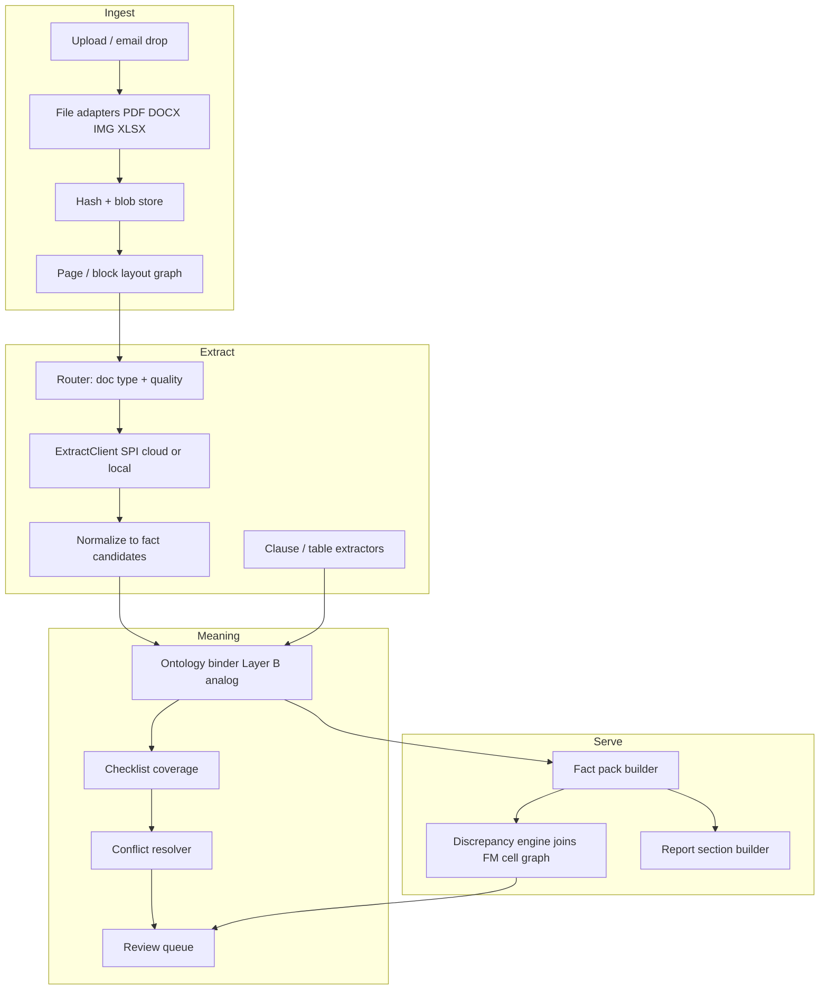
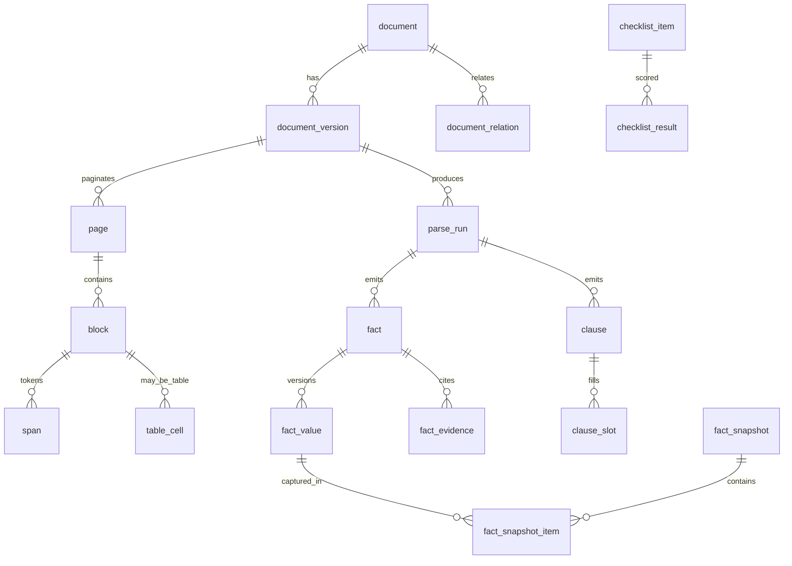

# TEV Document Intelligence Platform — Technical Architecture

**Audience:** AI coding agents and engineers implementing the non-Excel document layer of the TEV Automation platform.
**Stack:** Java 25 (Maven), SQLite (single file per mandate), file store for binaries.
**Companion documents:** `RKS_Schema.md` (Excel cell-graph DB), `CONTEXT.md` (FM Loader glossary), `TEV Automation BRD.md` (product requirements).
**Status:** Architecture baseline — implement against this unless an ADR supersedes it.

---

## 0. How to read this document

| Section | Use it when… |
|---|---|
| §1–2 | Deciding what to build and what to buy |
| §3–6 | Designing packages, tables, and entities |
| §7–10 | Implementing the extraction pipeline and document-type growth |
| §11–12 | Building report freshness and cross-document validation |
| §13–15 | Writing services, CLI, and tests |
| §16–18 | Security, sequencing, and shared vocabulary |

**Non-goals (do not implement without a new ADR):**

- Replacing or rewriting the existing Excel FM Loader / cell graph.
- A generic RAG chatbot over client documents (TEV needs structured, citable facts — not chat answers).
- Hard-deleting client source files from the workspace.
- Silently resolving conflicts between two credible sources (BRD §3.7.5).
- Inferring document meaning at raw-ingest time (same discipline as FM Loader).

---

## 1. Problem statement

The TEV platform already has a high-fidelity **financial model parser** that turns an Excel workbook into:

1. a **raw fact graph** (cells, formulas, styles, provenance),
2. **structural regions** (candidates, packets, triage),
3. **typed meaning** (nomenclature paths, amount roles, cell readings, evidence),
4. **operations** (parse runs, LLM usage, audit, review queue).

Client packages also contain **non-Excel documents** that must reach the same level of fidelity:

| Family | Examples | Hard parts |
|---|---|---|
| Promoter / net worth | CA certificates, ITR, bank statements, shareholding | Handwriting, stamps, multi-page schedules |
| Project definition | DPR, feasibility notes, site layouts | Long free text + tables, Indic languages |
| Commercial agreements | PPA, offtake, lease, EPC, TSA, SHA | Novel clause types every mandate |
| Regulatory | EC, CTU/grid, pollution, electricity, MoRTH, RERA | Form-like scans, seals, handwriting |
| Technical reports | PVsyst, wind rose, geotech, CEA/CERC filings | Dense tables, plots, units, curves |
| Quotations / BoQ | Vendor quotes, proforma invoices | Multi-currency, tax/freight lines, validity dates |
| Identity / KYC | PAN, GST, CIN, incorporation, board resolutions | Scans, logos, multi-language names |

**Product constraint (BRD):** every material fact in the TEV report must be evidence-backed, conflict-aware, and regenerable when documents change. Missing a fact is worse than a slow system.

---

## 2. Decisions (answer these first)

### D1 — Build vs LlamaIndex Extract (and similar)

**Decision: Hybrid — own the domain pipeline in Java; use commercial extractors as pluggable adapters, never as the system of record.**

| Layer | Who owns it | Why |
|---|---|---|
| Ingest, hashing, versioning, file store | **You (Java)** | Deterministic, audit-required, already matches FM Loader |
| Page/block/token layout + provenance | **You (Java)** | TEV needs cell-level-style lineage (`Sheet!A1` → `Doc!p12:bbox`) |
| OCR / layout / handwriting | **Adapter** (LlamaParse Extract v2.5, Google Document AI, Azure DI, local Tesseract/IndicOCR) | Commodity quality; Indic + handwriting is a moving target |
| Schema-guided field extraction | **Adapter for first pass; you store the result** | Extract v2.5 Value F1 ~96 with citations is strong for bounded fields |
| Ontology binding, amount roles, clause catalog, living leaves | **You (Java)** | Same living-ontology pattern as Excel Layer B |
| Completeness QA, conflict register, review workflow | **You (Java)** | Platform requirement; SaaS cannot express TEV rules |
| Report fact pack assembly | **You (Java)** | Must join Excel facts + document facts in one SQLite |

**Why not “just LlamaIndex”:**

1. Extract is excellent at *schema-shaped extraction with citations*, but TEV needs a **document cell graph** (blocks, spans, tables, handwriting flags) that you query like `RKS_workspace.db`. SaaS returns JSON + boxes, not a persistent joinable graph.
2. **Completeness** (“did we miss anything that belongs in the report?”) is a coverage problem over *your* checklists and ontology — not a vendor feature.
3. **Novel clauses** (§9) and **living ontology** must grow across mandates inside your DB.
4. Bank TEV work needs **local SQLite + file lineage**, reproducible parse runs (`parser_version + config_hash`), and offline re-queries after the vendor job is gone.
5. Cost/latency for 50+ page Indic scanned packs is unpredictable in a pure SaaS path; you need a **tiered routing** policy (§7.6).

**What to buy (recommended adapter set):**

- Primary cloud extract: **LlamaParse Extract v2.5** (`tier: agentic` for hard docs, `cost_effective` for clean English PDFs) — schema + `cite_sources` + `confidence_scores` + spreadsheet mode when needed.
- Secondary / fallback: Google Document AI or Azure DI for form-like regulatory scans.
- Local OCR floor: Tesseract + Indic language packs (or PaddleOCR) so the platform still produces a text layer when cloud is unavailable.
- Optional: a local VLM only if data-residency forbids cloud for some mandates.

**Integration rule:** every external call is behind `ExtractClient` (interface). Results are normalized into *your* tables before any report logic sees them. Never store “the LlamaIndex answer” as truth — store **normalized facts with provenance and extractor identity**.

```text
                    ┌──────────────────────────────────────────┐
                    │           Document Intelligence          │
                    │              (Java, SQLite)              │
                    │  ingest → layout → extract → bind → QA   │
                    └───────────────┬──────────────────────────┘
                                    │ ExtractClient SPI
          ┌─────────────────────────┼─────────────────────────┐
          ▼                         ▼                         ▼
   LlamaExtract v2.5         Google / Azure DI          Local OCR/VLM
   (schema + citations)      (forms, seals)             (offline floor)
```

### D2 — One database for Excel + documents?

**Decision: Yes — one SQLite workspace per mandate, containing both the FM cell graph and the document graph.**

Reasons:

- Phase 1–5 checks (BRD) are **cross-source**: promoter equity (cert) vs FM means-of-finance; PPA tariff vs revenue assumptions; DPR capacity vs production schedule. Joins beat API hops.
- The Excel pipeline already models `mandate_id`, `parse_run`, `provenance`, `review_queue`. Documents should be the same operational style.
- One backup / one hash / one report snapshot per mandate matches how TEV work is delivered.

**Do not** put all mandates in one growing SQLite file (see D3). **Do not** invent a second document DB that the report engine must dual-query.

**Layout on disk:**

```text
workspace/
  platform.db                          # optional multi-mandate registry (D3)
  mandates/
    {mandate_id}/
      workspace.db                     # Excel graph + document graph + report state
      blobs/
        {sha256}/original.ext          # content-addressed binaries (PDF, images, xlsx)
        {sha256}/pages/p001.png        # rendered pages for UI + OCR
        {sha256}/layout.json           # optional cached layout from extractors
      runs/
        {parse_run_id}/                # run artifacts, logs, redacted exports
```

### D3 — One DB per mandate vs one DB for all mandates?

**Decision: One `workspace.db` per mandate + a small optional `platform.db` for registry only.**

| Concern | Per-mandate workspace.db | Single mega-DB |
|---|---|---|
| Client confidentiality / export | Zip one folder; hand to bank | Hard to isolate |
| Backup & retention | Per engagement | Coupled |
| SQLite write contention | One team working one mandate | Cross-mandate locks |
| Cross-mandate learning (ontology packs) | Copy packs in / export leaves out | Easier, but not worth isolation cost |
| Schema migration blast radius | Migrate on open | Migrate everything |

**`platform.db` holds only:**

- `mandate` (id, client name, industry, status, workspace path)
- `doc_type_pack` registry (id, name, version, file hash of pack definition)
- shared ontology **spine** (frozen) and published **industry packs**
- optional job queue if a single worker process serves many mandates

**Mandate-specific growth** (soft leaves, aliases, new clause types) lives in `workspace.db`, exactly like the Excel “mandate_soft” layer in `RKS_Schema.md`.

### D4 — Document updates, amendments, deletions, and report freshness

**Decision: Immutable versions + logical document identity + supersession graph + effective-dated facts. The report always rebuilds from “current effective fact state,” never from a stale extract cache.**

Rules:

1. **Never mutate a `document_version`.** New bytes → new version (new `sha256`).
2. **Logical `document`** groups versions (e.g. “PPA”, “Promoter NW Certificate — Mr. X”).
3. **Relations** model reality: `supersedes`, `amends`, `extends`, `annexes_to`, `withdraws`, `replaces_page_set`.
4. **Facts and clauses** are extracted *from a version* and carry validity (`valid_from`, `valid_to`, `is_current`) and `superseded_by_fact_id`.
5. **Analyst deletion** is a soft state on the logical document (`active | withdrawn | replaced | deleted_by_analyst`) — blobs stay for audit unless a retention job purges them under policy.
6. **Report sections** store a `fact_snapshot_id` of the fact pack used at confirmation time. New versions mark dependent sections `stale` and require reconfirmation (BRD Phase 5).
7. **Parse runs** are keyed by `(document_version_id, parser_version, config_hash, extractor_bundle_version)` so re-runs are comparable and replaceable.

Example: PPA v1 (tariff ₹4.5) → PPA Amendment 1 (tariff ₹4.8, COD extended). After ingest + extract + supersession resolution, `Project > Offtake Tariff` current value is 4.8 with provenance to Amendment 1; v1 remains queryable as history.

---

## 3. Design principles (mirror the Excel pipeline)

1. **Raw is exact. Meaning is derived.** Store blocks/spans/tables as facts; store paths, clause types, and “about” text as machine-derived layers with evidence.
2. **Provenance or it did not happen.** Every fact, clause, and checklist item points to `document_version_id` + page + bbox (or char offsets) + verbatim quote.
3. **Unbound is a successful result.** Prefer `unbound` + reason over a wrong ontology path (same as Layer B).
4. **Living ontology.** Frozen spine + industry packs + mandate soft leaves. Fit an existing leaf before inventing one. Never wipe soft leaves at extract start.
5. **Human gates stay.** Extraction feeds bullets / discrepancy register / report sections; it does not auto-finalize (BRD).
6. **Conflicts surface.** Two sources, two values → conflict row, not a silent pick (unless an explicit precedence rule is configured).
7. **Coverage is measurable.** Checklists and ontology leaves drive completeness reports (“DPR technical section: 12/14 fields bound”).
8. **Idempotent parse runs.** Re-extract replaces the interpretation snapshot for that run; it does not append garbage.
9. **No meaning at ingest.** File adapters only normalize bytes → pages/blocks/tokens. Classification and binding are later stages.

---

## 4. System architecture overview



**Same three meaning layers as Excel:**

| Excel (RKS) | Document platform |
|---|---|
| `cell`, `formula_link`, `provenance` | `block`, `span`, `table_cell`, `provenance` |
| `candidate` / `packet_disposition` | `doc_region` / `region_disposition` (section, schedule, form panel) |
| `nomenclature_binding` + `cell_reading` | `fact` + `fact_value` + `clause` |
| `parse_run`, `llm_usage`, `review_queue` | same names, same roles |

---

## 5. Data architecture

### 5.1 SQLite topology

| File | Contents | Written by |
|---|---|---|
| `platform.db` | mandate registry, pack registry, shared spine | platform admin tools |
| `mandates/{id}/workspace.db` | FM graph **and** document graph **and** report state | `tev-parse`, `tev-doc`, report engine |
| `blobs/` | immutable source bytes and page rasters | ingest only |

Connection settings (document in code):

- `journal_mode=WAL`, `foreign_keys=ON`, `busy_timeout=5000`
- `synchronous=NORMAL` (workspace) — durability is via file copy of `workspace.db` + blobs
- Migrations: `schema_migration` table, same pattern as FM Loader
- Never put large PDFs as SQLite blobs; store `sha256` + relative path only

### 5.2 What lives in the same workspace.db

Reuse (do not fork) existing operational tables where possible:

- `mandate_id` on every run-scoped table
- `source_file` extended with `file_role` (`fm_workbook | dpr | agreement | certificate | quotation | technical_report | other`)
- `parse_run`, `audit_log`, `run_stat`, `run_timing`, `llm_usage`, `review_queue`, `schema_migration`

New domain groups (see §6):

| Group | Tables |
|---|---|
| Document identity & versions | `document`, `document_version`, `document_relation`, `document_label` |
| Layout graph | `page`, `block`, `span`, `table_grid`, `table_cell`, `layout_edge` |
| Regions | `doc_region`, `doc_region_member`, `region_disposition` |
| Meaning | `fact`, `fact_value`, `fact_evidence`, `clause`, `clause_slot`, `checklist_item`, `checklist_result` |
| Ontology | `doc_ontology_node`, `doc_ontology_alias`, `doc_type_pack`, `doc_type_pack_item` |
| Report freshness | `fact_snapshot`, `fact_snapshot_item`, `section_dependency`, `section_state` |

---

## 6. Core data model

### 6.1 Entity relationship (logical)



### 6.2 Document identity and versioning (D4)

```sql
CREATE TABLE document (
  document_id     INTEGER PRIMARY KEY AUTOINCREMENT,
  mandate_id      INTEGER NOT NULL,
  logical_name    TEXT NOT NULL,          -- 'PPA', 'Promoter NW - Sharma'
  doc_family      TEXT NOT NULL,          -- controlled: see §8
  doc_type_code   TEXT,                   -- pack code when classified
  status          TEXT NOT NULL DEFAULT 'active'
                  CHECK (status IN ('active','withdrawn','replaced','deleted_by_analyst')),
  current_version_id INTEGER REFERENCES document_version(document_version_id),
  created_at      TEXT NOT NULL,
  updated_at      TEXT NOT NULL
);

CREATE TABLE document_version (
  document_version_id INTEGER PRIMARY KEY AUTOINCREMENT,
  document_id     INTEGER NOT NULL REFERENCES document(document_id),
  version_label   TEXT NOT NULL,          -- 'v1', 'Amendment-1', 'signed-2026-03-12'
  file_name       TEXT NOT NULL,
  file_hash       TEXT NOT NULL,          -- sha256 of bytes
  file_ext        TEXT NOT NULL,
  file_role       TEXT NOT NULL,
  page_count      INTEGER,
  lang_primary    TEXT,                   -- ISO 639-3, may be multi via document_label
  ocr_required    INTEGER NOT NULL DEFAULT 0 CHECK (ocr_required IN (0,1)),
  ingest_status   TEXT NOT NULL DEFAULT 'ingested'
                  CHECK (ingest_status IN ('ingested','layout_ok','extracted','failed','rejected')),
  ingested_at     TEXT NOT NULL,
  raw_metadata    TEXT,                   -- JSON: EXIF, PDF producer, etc.
  UNIQUE (document_id, file_hash)
);

CREATE TABLE document_relation (
  relation_id     INTEGER PRIMARY KEY AUTOINCREMENT,
  from_document_version_id INTEGER NOT NULL REFERENCES document_version(document_version_id),
  to_document_version_id   INTEGER NOT NULL REFERENCES document_version(document_version_id),
  relation_kind   TEXT NOT NULL CHECK (relation_kind IN (
                    'supersedes','amends','extends','annexes_to','withdraws','duplicate_of','related')),
  note            TEXT,
  created_at      TEXT NOT NULL,
  UNIQUE (from_document_version_id, to_document_version_id, relation_kind)
);
```

**Resolution of “current truth” for a logical document:**

1. Prefer `document.current_version_id` if set by analyst.
2. Else walk `supersedes`/`amends` edges to the terminal version.
3. Facts from earlier versions remain in history with `valid_to` set when a later version restates the same ontology leaf.

### 6.3 Layout graph (document “cell graph”)

Keep raw geometry **deterministic** — no LLM here.

```sql
CREATE TABLE page (
  page_id         INTEGER PRIMARY KEY AUTOINCREMENT,
  document_version_id INTEGER NOT NULL REFERENCES document_version(document_version_id),
  page_index      INTEGER NOT NULL,      -- 1-based
  width_px        INTEGER, height_px INTEGER,
  image_path      TEXT,                  -- relative under blobs/{hash}/pages/
  ocr_engine      TEXT,
  ocr_confidence  REAL,
  lang_detected   TEXT,
  UNIQUE (document_version_id, page_index)
);

CREATE TABLE block (
  block_id        INTEGER PRIMARY KEY AUTOINCREMENT,
  page_id         INTEGER NOT NULL REFERENCES page(page_id),
  block_index     INTEGER NOT NULL,      -- reading order on page
  block_kind      TEXT NOT NULL CHECK (block_kind IN (
                    'paragraph','heading','table','list','form_field','footer','header',
                    'stamp','signature','handwriting','figure','unknown')),
  bbox_x0 REAL, bbox_y0 REAL, bbox_x1 REAL, bbox_y1 REAL,
  text_raw        TEXT,                  -- exact OCR/text as extracted
  text_norm       TEXT,                  -- whitespace-normalized, no translation
  reading_order   INTEGER,
  is_handwritten  INTEGER NOT NULL DEFAULT 0 CHECK (is_handwritten IN (0,1)),
  ocr_confidence  REAL,
  extractor       TEXT,                  -- which adapter produced this block
  UNIQUE (page_id, block_index)
);

CREATE TABLE span (
  span_id         INTEGER PRIMARY KEY AUTOINCREMENT,
  block_id        INTEGER NOT NULL REFERENCES block(block_id),
  span_index      INTEGER NOT NULL,
  text_raw        TEXT NOT NULL,
  bbox_x0 REAL, bbox_y0 REAL, bbox_x1 REAL, bbox_y1 REAL,
  confidence      REAL
);

CREATE TABLE table_grid (
  table_grid_id   INTEGER PRIMARY KEY AUTOINCREMENT,
  block_id        INTEGER NOT NULL REFERENCES block(block_id),
  n_rows INTEGER, n_cols INTEGER,
  header_row_count INTEGER DEFAULT 0
);

CREATE TABLE table_cell (
  table_cell_id   INTEGER PRIMARY KEY AUTOINCREMENT,
  table_grid_id   INTEGER NOT NULL REFERENCES table_grid(table_grid_id),
  row_index INTEGER NOT NULL,
  col_index INTEGER NOT NULL,
  text_raw        TEXT,
  bbox_x0 REAL, bbox_y0 REAL, bbox_x1 REAL, bbox_y1 REAL,
  row_span INTEGER DEFAULT 1, col_span INTEGER DEFAULT 1,
  is_header INTEGER NOT NULL DEFAULT 0 CHECK (is_header IN (0,1))
);

CREATE TABLE provenance_doc (
  provenance_id   INTEGER PRIMARY KEY AUTOINCREMENT,
  entity_type     TEXT NOT NULL,  -- 'fact'|'clause'|'block'|'checklist_result'|'region'
  entity_id       INTEGER NOT NULL,
  document_version_id INTEGER NOT NULL REFERENCES document_version(document_version_id),
  page_id         INTEGER REFERENCES page(page_id),
  block_id        INTEGER REFERENCES block(block_id),
  span_id         INTEGER REFERENCES span(span_id),
  table_cell_id   INTEGER REFERENCES table_cell(table_cell_id),
  bbox_x0 REAL, bbox_y0 REAL, bbox_x1 REAL, bbox_y1 REAL,
  char_start INTEGER, char_end INTEGER,
  verbatim        TEXT NOT NULL,          -- exact quote in source language
  quote_hash      TEXT,                   -- hash of normalized quote for re-anchor
  confidence      REAL,
  is_derived      INTEGER NOT NULL DEFAULT 0 CHECK (is_derived IN (0,1)),
  notes           TEXT
);
```

**UI rule:** clicking any fact in the report opens the page image with the bbox highlighted (BRD data lineage requirement).

### 6.4 Regions (Layer A analog)

```sql
CREATE TABLE doc_region (
  region_id       INTEGER PRIMARY KEY AUTOINCREMENT,
  parse_run_id    INTEGER NOT NULL REFERENCES parse_run(parse_run_id),
  document_version_id INTEGER NOT NULL,
  region_kind     TEXT NOT NULL CHECK (region_kind IN ('document','section','panel','table_set','schedule','annex')),
  parent_region_id INTEGER REFERENCES doc_region(region_id),
  title_guess     TEXT,
  page_start INTEGER, page_end INTEGER,
  structural_role TEXT CHECK (structural_role IS NULL OR structural_role IN ('main','helper','scratch')),
  structural_confidence REAL,
  explanation     TEXT,
  created_at      TEXT NOT NULL
);

CREATE TABLE region_disposition (
  parse_run_id    INTEGER NOT NULL,
  region_id       INTEGER NOT NULL REFERENCES doc_region(region_id),
  schedule_family TEXT,     -- 'agreement_terms','net_worth','technical','regulatory','quotation','ppa_evidence',...
  triage          TEXT NOT NULL CHECK (triage IN ('main','scratch','orphan')),
  relevance       TEXT NOT NULL CHECK (relevance IN ('primary','supporting','noise')),
  about           TEXT,     -- short paragraph, LLM-derived, for later binding + retrieval
  headers_json    TEXT,
  created_at      TEXT NOT NULL,
  PRIMARY KEY (parse_run_id, region_id)
);
```

### 6.5 Facts and clauses (Layer B analog)

**Fact** = a named, typed assertion the report can cite (capacity, COD, tariff, net worth, promoter name…).
**Clause** = a contractual/regulatory provision that may not fit a fixed leaf (change-in-law, termination, force majeure, PPA tenure…).

```sql
CREATE TABLE fact (
  fact_id         INTEGER PRIMARY KEY AUTOINCREMENT,
  parse_run_id    INTEGER NOT NULL REFERENCES parse_run(parse_run_id),
  document_version_id INTEGER NOT NULL,
  region_id       INTEGER REFERENCES doc_region(region_id),
  ontology_path   TEXT,            -- living path, see §9; NULL = unbound
  path_root       TEXT CHECK (path_root IS NULL OR path_root IN (
                    'identity','economic','technical','commercial','legal','regulatory','frame')),
  subject_entity  TEXT,            -- 'Borrower','Promoter:Ramesh Sharma','SPV','Lender:SIDBI'
  value_kind      TEXT NOT NULL CHECK (value_kind IN (
                    'money','quantity','rate','percent','date','duration','text','enum','boolean','list')),
  value_text      TEXT,            -- normalized text representation
  value_number    REAL,
  value_date      TEXT,            -- ISO date when precise
  unit            TEXT,
  currency        TEXT,
  scale           TEXT CHECK (scale IS NULL OR scale IN (
                    'unit','thousand','lakh','million','crore','billion')),
  absolute_amount TEXT,            -- money only when scale known (same rule as cell_reading)
  lang_source     TEXT,
  extraction_method TEXT NOT NULL CHECK (extraction_method IN (
                    'deterministic','llm_field','llm_open','human','derived')),
  extractor_id    TEXT,            -- 'llama-extract-2.5-agentic' etc.
  confidence      REAL,
  nomenclature_status TEXT NOT NULL CHECK (nomenclature_status IN ('bound','unbound','not_applicable')),
  unbound_reason  TEXT,
  valid_from      TEXT,
  valid_to        TEXT,            -- NULL = still effective from this version
  is_current      INTEGER NOT NULL DEFAULT 1 CHECK (is_current IN (0,1)),
  superseded_by_fact_id INTEGER REFERENCES fact(fact_id),
  created_at      TEXT NOT NULL,
  UNIQUE (parse_run_id, document_version_id, fact_id)
);

CREATE TABLE fact_value (
  fact_value_id   INTEGER PRIMARY KEY AUTOINCREMENT,
  fact_id         INTEGER NOT NULL REFERENCES fact(fact_id),
  value_text      TEXT,
  value_number    REAL,
  value_date      TEXT,
  unit TEXT, currency TEXT, scale TEXT, absolute_amount TEXT,
  change_reason   TEXT,            -- 'amendment','restatement','correction','human_edit'
  document_version_id INTEGER NOT NULL,
  created_at      TEXT NOT NULL
);

CREATE TABLE fact_evidence (
  fact_id         INTEGER NOT NULL REFERENCES fact(fact_id),
  ordinal         INTEGER NOT NULL,
  role            TEXT NOT NULL CHECK (role IN (
                    'verbatim_quote','table_cell','label','period','unit','currency','scale',
                    'signature_block','stamp','handwriting','derived_from')),
  provenance_id   INTEGER REFERENCES provenance_doc(provenance_id),
  source_text     TEXT,
  resolution      TEXT NOT NULL CHECK (resolution IN ('resolved','missing','ambiguous')),
  normalized_value TEXT,
  rule_id         TEXT,
  PRIMARY KEY (fact_id, ordinal)
);

CREATE TABLE clause (
  clause_id       INTEGER PRIMARY KEY AUTOINCREMENT,
  parse_run_id    INTEGER NOT NULL,
  document_version_id INTEGER NOT NULL,
  region_id       INTEGER REFERENCES doc_region(region_id),
  clause_type     TEXT,            -- living type: 'ppa.termination', 'sha.transfer_restriction', ...
  clause_type_status TEXT NOT NULL CHECK (clause_type_status IN ('bound','open','not_applicable')),
  heading         TEXT,
  clause_text     TEXT NOT NULL,   -- verbatim body
  lang_source     TEXT,
  summary_en      TEXT,            -- optional English gloss for report drafting
  materiality     TEXT CHECK (materiality IS NULL OR materiality IN ('high','medium','low','unknown')),
  is_boilerplate  INTEGER NOT NULL DEFAULT 0 CHECK (is_boilerplate IN (0,1)),
  novelty_score   REAL,            -- high when no known clause_type matched
  extraction_method TEXT NOT NULL,
  confidence      REAL,
  valid_from TEXT, valid_to TEXT,
  is_current      INTEGER NOT NULL DEFAULT 1 CHECK (is_current IN (0,1)),
  superseded_by_clause_id INTEGER REFERENCES clause(clause_id),
  created_at      TEXT NOT NULL
);

CREATE TABLE clause_slot (
  clause_id       INTEGER NOT NULL REFERENCES clause(clause_id),
  slot_name       TEXT NOT NULL,   -- 'notice_period_days','tariff','tenor_years','governing_law'
  slot_value_text TEXT,
  slot_value_number REAL,
  slot_value_date TEXT,
  unit TEXT, currency TEXT, scale TEXT,
  provenance_id   INTEGER REFERENCES provenance_doc(provenance_id),
  confidence      REAL,
  PRIMARY KEY (clause_id, slot_name)
);
```

### 6.6 Ontology tables (living, not fixed forever)

```sql
CREATE TABLE doc_ontology_node (
  node_id         INTEGER PRIMARY KEY AUTOINCREMENT,
  path            TEXT NOT NULL UNIQUE,   -- 'Commercial > Offtake > Tariff'
  name            TEXT NOT NULL,
  parent_path     TEXT,
  root            TEXT NOT NULL CHECK (root IN (
                    'identity','economic','technical','commercial','legal','regulatory','frame')),
  layer           TEXT NOT NULL CHECK (layer IN ('spine','industry','mandate_soft')),
  industry_tag    TEXT,
  mandate_id      INTEGER,
  leaf            INTEGER NOT NULL CHECK (leaf IN (0,1)),
  frozen          INTEGER NOT NULL CHECK (frozen IN (0,1)),
  value_kind      TEXT,                   -- preferred fact value_kind for leaves
  report_section  TEXT,                   -- which TEV section consumes this leaf
  created_at      TEXT NOT NULL
);

CREATE TABLE doc_ontology_alias (
  alias_id        INTEGER PRIMARY KEY AUTOINCREMENT,
  alias_text      TEXT NOT NULL,          -- 'tariff', 'PPA rate', '₹/kWh'
  lang            TEXT,
  leaf_path       TEXT NOT NULL,
  layer           TEXT NOT NULL,
  mandate_id      INTEGER,
  created_at      TEXT NOT NULL
);
```

**Seeded spine (minimum — extend in packs):**

| Root | Example leaves (frozen spine) |
|---|---|
| identity | Legal Name, CIN, PAN, GSTIN, Constitution, Registered Office, Directors, Promoters, Shareholding % |
| economic | Promoter Net Worth, Project Cost, Means of Finance > Equity/Debt, Capex heads, Tariff, Revenue basis |
| technical | Capacity, Technology, COD, Location, Land area, PLF/CUF, Yield, Fuel/Water requirement |
| commercial | Offtake term, PPA tenure, Termination, Change in Law, Payment security, Escalation |
| legal | Governing law, Dispute resolution, Assignment, Change of control, Force majeure |
| regulatory | EC conditions, Grid connectivity, Consents obtained/expired, Compliance certificates |
| frame | Document title, Party names block, Signature block, Annexure marker, Stamp, Page footer |

### 6.7 Completeness (checklists)

```sql
CREATE TABLE checklist_item (
  checklist_item_id INTEGER PRIMARY KEY AUTOINCREMENT,
  doc_type_code   TEXT NOT NULL,     -- or '*'
  mandate_id      INTEGER,           -- NULL = global
  path            TEXT NOT NULL,     -- ontology path this item wants
  required_for_report_section TEXT,  -- 'financial_viability', ...
  min_sources     INTEGER DEFAULT 1,
  is_mandatory    INTEGER NOT NULL DEFAULT 0 CHECK (is_mandatory IN (0,1)),
  note            TEXT
);

CREATE TABLE checklist_result (
  parse_run_id    INTEGER NOT NULL,
  checklist_item_id INTEGER NOT NULL REFERENCES checklist_item(checklist_item_id),
  status          TEXT NOT NULL CHECK (status IN (
                    'satisfied','missing','partial','conflict','ambiguous','not_applicable')),
  fact_ids_json   TEXT,
  detail          TEXT,
  updated_at      TEXT NOT NULL,
  PRIMARY KEY (parse_run_id, checklist_item_id)
);
```

This is how the platform answers *“did we miss a data point that belongs in the report?”* — not by hoping the LLM was thorough.

---

## 7. Extraction pipeline

### 7.1 Stages (names align with FM Loader style)

| Stage | Command sketch | Deterministic? | Output |
|---|---|---|---|
| `ingest` | `tev-doc ingest --mandate --file` | Yes | `document_version`, blobs, `page` placeholders |
| `layout` | `tev-doc layout --version` | Mostly (OCR may be neural) | `block`, `span`, `table_*` |
| `discover` | `tev-doc discover --run` | Yes | `doc_region` coverage (document-level parent + sections) |
| `classify` | `tev-doc classify --run` | LLM | `region_disposition`, `about`, doc type suggestion |
| `extract` | `tev-doc extract --run` | LLM + rules | `fact` candidates, `clause` candidates |
| `bind` | `tev-doc bind --run` | Rules + LLM | ontology paths, slots, `nomenclature_status` |
| `qa` | `tev-doc qa --run` | Yes + LLM | checklist results, conflicts, review_queue |
| `pack` | `tev-doc pack --snapshot` | Yes | `fact_snapshot` for report assembly |

Every stage writes `run_stat` / `run_timing` / `llm_usage` / `audit_log` like the Excel pipeline.

### 7.2 Parse run identity

```text
parse_run_id
  source: document_version_id (or fm workbook)
  parser_version
  config_hash          -- routing rules, checklist pack, ontology slice hash
  extractor_bundle_version
  status: success | partial | failed | rejected
  UNIQUE (document_version_id, parser_version, config_hash)
```

Re-running with the same identity **replaces** interpretation snapshots for that run (facts/clauses/checklists), it does not duplicate.

### 7.3 Routing (quality + language)

```text
if file is xlsx/xls/csv with formulas → FM Loader path (existing)
else:
  classify file_role from name + first-page text + checklist template
  detect language(s) on page samples
  detect scan quality (DPI, skew, handwriting blocks, seal overlap)
  route:
    clean digital PDF English     → Extract cost_effective + local text
    clean digital + Indic         → Extract agentic + Indic-aware OCR
    scanned form / handwriting    → high-res page OCR + Extract agentic + local handwriting model
    dense technical (PVsyst)      → spreadsheet/table mode extract + table_grid pipeline
    unknown                       → agentic + open extraction pass (§9)
```

### 7.4 Field extraction (schema-guided)

For each `doc_type_pack` (§8), build a JSON Schema of required/optional leaves and call `ExtractClient.extract(schema, pages, instructions)`.

**Must store per field:**

- normalized value + raw value
- confidence
- bounding-box citations (map to `provenance_doc`)
- whether value is **stated** or **derived** (e.g. net worth = assets − liabilities)
- multi-value support (list of directors, list of quotations)

**Java normalization rules (deterministic after extract):**

- Money: parse `₹`, `Rs.`, `INR`, `lakh/crore/million` → `absolute_amount` using the same scale multiplier table as Excel (unit 1, lakh 1e5, million 1e6, crore 1e7).
- Dates: Indian formats (`12/03/2026`, `March 2026`, `FY 2025-26`) → ISO when precise; keep verbatim always.
- Percent / rate: never invent units; leave `unit` empty and evidence `ambiguous` if unstated.
- Names: keep source script in `verbatim`; store Latin transliteration separately if needed for search (`fact_evidence.role='verbatim_quote'` + optional alias row).

### 7.5 Table extraction (quotations, PVsyst, net-worth schedules)

1. Prefer `table_grid` / `table_cell` from layout (deterministic).
2. If extractor returns structured rows, **align** them to `table_cell` by bbox overlap; do not replace geometry.
3. Emit **row facts** (e.g. one quotation line) as `fact` with `path_root='economic'` and parent `region` = quotation.
4. Preserve grouping keys: vendor, package, validity, tax/freight flags (BRD FR-1.3).

### 7.6 ExtractClient SPI (Java)

```java
public interface ExtractClient {
  String id(); // "llama-extract-2.5-agentic"
  ExtractResult extractFieldSchema(ExtractRequest req, JsonNode schema);
  ExtractResult extractOpen(ExtractRequest req, OpenExtractSpec spec); // clauses / novel
  LayoutResult extractLayout(ExtractRequest req); // blocks/tables if adapter provides
}

public record ExtractRequest(
    Path pageBundleDir,
    List<Integer> pageIndices,
    String langHint,
    String docTypeCode,
    String instructions,
    Map<String,String> options) {}

public record ExtractResult(
    String extractorId,
    JsonNode payload,          // raw adapter payload (stored for audit)
    List<FactCandidate> facts,
    List<ClauseCandidate> clauses,
    List<Citation> citations,  // page + bbox + quote
    ExtractStats stats) {}
```

Config keys (via existing `config.json` / env):

- `extract.primary`, `extract.fallback`, `extract.local_ocr`
- `extract.max_usd_per_document`, `extract.timeout_ms`
- API keys via environment only — never in workspace.db

---

## 8. Scaling document types (packs, not code forks)

### 8.1 What is a `doc_type_pack`?

A **versioned data pack** (JSON or YAML checked into repo, registered in `platform.db`) that defines:

```yaml
code: ppa.power_purchase
version: 1.3.0
family: agreement
industry_tags: [solar_power, wind_power, hybrid]
languages_hint: [en, hi]
file_role: agreement
identity_signals:
  - any_of: ["Power Purchase Agreement", "PPA", "विद्युत क्रय समझौता"]
regions:
  - key: parties
    schedule_family: agreement_terms
  - key: commercial_terms
    schedule_family: commercial
fields:                      # JSON Schema fragment for ExtractClient
  - path: Commercial > Offtake > Tariff
    value_kind: money
    required: true
    slots: [currency, scale, unit]
  - path: Commercial > Offtake > Tenor
    value_kind: duration
    required: true
  - path: Commercial > Offtake > COD
    value_kind: date
    required: false
clauses:
  bind_types:                # closed set for THIS pack
    - ppa.termination
    - ppa.change_in_law
    - ppa.payment_security
    - ppa.force_majeure
  open_extract: true         # always also run novelty pass (§9)
checklist:
  - path: Commercial > Offtake > Tariff
    is_mandatory: true
    required_for_report_section: financial_viability
report_sections: [financial_viability, technical_viability, risk]
```

### 8.2 How the system scales project-by-project

| Situation | Mechanism |
|---|---|
| Known type (PPA) | Load pack → schema extract → bind to pack leaves |
| Known family, new variant (state PPA rider) | Open clause pass + analyst promotes new `clause_type` into pack version |
| Entirely new type (PVsyst report) | Author new pack (fields + checklist) without changing Java core; temporary `doc_type_code='unknown'` + open extract until pack ships |
| New industry (hotel, hospital) | Industry pack adds leaves under known parents (like Excel `industry` layer) |
| Mandate-specific oddity | Soft leaf in `workspace.db` only (`layer='mandate_soft'`) |
| Recurring soft leaf across mandates | Promote to industry pack / spine via pack publish process |

**Core Java code should only know:** pack loading, schema compile, generic fact/clause persistence, bind/QA engines. **Pack content never requires a release.**

### 8.3 First-wave packs to author

1. `identity.promoter_net_worth`
2. `identity.audited_financials` (BS/P&L/notes — for Phase 1 historical checks)
3. `project.dpr`
4. `agreement.ppa` / `agreement.offtake`
5. `agreement.sha_shareholders`
6. `agreement.loan_sanction`
7. `quotation.vendor` (BoQ)
8. `technical.pvsyst`
9. `regulatory.environment_clearance`
10. `regulatory.grid_connectivity`

---

## 9. Novel clauses and open schema (the hard part)

Fixed schemas **cannot** cover every agreement. The platform must continuously discover clause types without losing auditability.

### 9.1 Three-pass clause pipeline

```text
Pass A — Pack bind
  Match clause headings + text against pack.bind_types (regex/alias + LLM confirm).
  Result: clause_type_status='bound'

Pass B — Open type proposal
  For unbound clauses: LLM proposes (clause_type, parent_family, slots, materiality, summary).
  novelty_score high if no close existing type.
  Result: clause_type_status='open', stored with full verbatim text.

Pass C — Human promotion
  Review UI groups similar open types across the mandate (embedding on clause_text).
  Analyst: promote to pack | rename/merge into existing type | dismiss as boilerplate.
  Promotion writes doc_ontology_alias + may bump doc_type_pack.version.
```

### 9.2 Embeddings store (optional but recommended)

- Store `clause.embedding` as BLOB (float32 array) or a sidecar `clause_embedding` table.
- Similarity search is for **review grouping and retrieval**, never for silent merge.
- Local model (e.g. multilingual E5 / GTE) keeps client text off third-party embedding APIs if required.

### 9.3 What always stays structured even for open clauses

- verbatim `clause_text` (+ language)
- page/bbox provenance
- document version + whether later amendment superseded it
- extracted **slots** when obvious (dates, amounts, notice periods) as `clause_slot`
- materiality flag for risk section drafting

This is how “agreements we have seen before still introduce important new clauses” is handled **without** unbounded schema growth and **without** losing the clause.

---

## 10. Multilingual, scanned, handwritten documents

### 10.1 Text model

Every block keeps:

| Field | Meaning |
|---|---|
| `text_raw` | Exact OCR/extract text in source script |
| `text_norm` | Normalized whitespace/punctuation only — **no translation** |
| `lang_detected` | Per page / block |
| optional `text_en` | English gloss (LLM), stored on fact/clause summary fields, **not** as the only copy |

Search: SQLite FTS5 over `text_raw` + `text_norm` + aliases; optional transliteration index for Indic → Latin queries.

### 10.2 OCR strategy

| Input | Pipeline |
|---|---|
| Born-digital PDF | Extract embedded text; OCR only if extraction quality low |
| Scanned English | 300 DPI render → OCR → layout |
| Scanned Indic | Language-specific OCR (Tesseract hin+mar+ben+… or commercial); store `ocr_engine` per page |
| Handwriting-heavy | VLM/extract agentic on page images; mark `block.is_handwritten=1`; confidence thresholds stricter |
| Mixed print + handwriting + stamps | Extract v2.5 style structural reasoning; keep separate blocks for stamp/signature |

### 10.3 QA gates for low-quality text

- If mean OCR confidence < threshold → `review_queue` item `ocr_low_confidence`
- If a **mandatory checklist** fact’s evidence confidence < threshold → status `ambiguous`, never auto-satisfy
- Always retain page image as source of truth for the human reviewer

---

## 11. Report freshness and controlled updates (D4 operationalized)

### 11.1 Fact snapshots

When an analyst confirms a report section, capture:

```text
fact_snapshot
  snapshot_id, mandate_id, created_at, created_by, reason
fact_snapshot_item
  snapshot_id, fact_id | clause_id, value copied, provenance_id, ontology_path
```

Section state:

```text
section_state(section_key, status: draft|bullets_ready|confirmed|stale|final,
              snapshot_id, confirmed_at, confirmed_by)
```

### 11.2 Change impact

On new `document_version` or re-extract or analyst withdrawal:

1. Resolve current facts per ontology leaf (latest effective).
2. Diff against each section’s `fact_snapshot`.
3. Mark sections with material diffs `stale` and write `section_dependency` explanation.
4. UI: “PPA amendment changed Tariff and Tenor → Financial Viability + Risk require review.”
5. Regenerated content still needs analyst confirmation (BRD).

### 11.3 Deletion / withdrawal semantics

| User action | DB effect | Report effect |
|---|---|---|
| Upload replacement file | new `document_version` + relation `supersedes` | re-extract → fact supersession → stale sections |
| Mark document withdrawn | `document.status='withdrawn'` | facts from that version lose `is_current` if not corroborated |
| Analyst deletes document | `status='deleted_by_analyst'` | exclude from fact packs; keep history; audit_log entry |
| True purge (policy) | blob delete job | only after retention window + explicit admin action |

**Never hard-delete during an active mandate.**

---

## 12. Cross-source validation (documents × Excel cell graph)

The discrepancy engine (BRD Phase 1) queries **both** graphs in one workspace.db:

| Check family | Document side | Excel side |
|---|---|---|
| Promoter equity | `identity/economic` net worth & contribution facts | `Means of Finance > Promoter / Partners' Capital` |
| Project cost vs quotes | quotation row facts (gross, tax, freight) | `Project Cost` paths, `amount_role='add'` |
| Capacity / yield | DPR / PVsyst technical facts | production & capacity assumptions |
| Debt terms | sanction letter facts (rate, tenor, moratorium) | debt amortization assumptions |
| Tariff / offtake | PPA facts/clauses | revenue assumptions |
| Identity | legal name, directors | `identity` path cells |

Conflict row schema (reuse `review_queue` + a `conflict` table if needed):

```text
conflict_id, mandate_id, left_entity (fact/cell), right_entity,
left_value, right_value, path, severity, status, resolution,
precedence_rule_id (nullable), created_at
```

Default policy: **surface, do not auto-pick** (BRD §3.7.5).

---

## 13. Completeness and quality guarantees

The system must answer, per mandate and per report section:

1. **Checklist coverage** — mandatory leaves satisfied / missing / conflict.
2. **Binding coverage** — % of extracted facts bound vs unbound (with reasons).
3. **Provenance coverage** — % of report-cited values with page+bbox (target 100% for material values).
4. **Version currency** — any fact used by a section that is not `is_current`.
5. **Extractor audit** — which adapter produced which fact (cost, model, version).

`tev-doc qa --run` writes these metrics to `run_stat` and a human-readable QA report.

**Definition of “not missing a data point”:** every `checklist_item` for the applicable packs is `satisfied` or explicitly waived by an analyst with a reason — never silently skipped.

---

## 14. Java implementation map

```text
com.resurgent.tev.doc
  ingest/        FileAdapter, PdfAdapter, DocxAdapter, ImageAdapter, BlobStore, PageRenderer
  layout/        Block, Span, TableGrid, LayoutGraphWriter, OcrClient
  region/        DiscoverService, ClassifyService, RegionDisposition
  extract/       ExtractClient, LlamaExtractClient, DocumentAiClient, LocalOcrClient
  extract/model/ FactCandidate, ClauseCandidate, Citation, ExtractResult
  bind/          OntologyBinder, AliasMatcher, AmountNormalizer, DateNormalizer
  clause/        ClausePassA_Binder, OpenClauseProposer, PromotionService, EmbeddingIndex
  pack/          DocTypePack, PackLoader, SchemaCompiler, PackRegistry
  qa/            ChecklistService, ConflictService, CoverageReport, ReviewQueueWriter
  version/       DocumentService, RelationResolver, SupersessionService
  snapshot/      FactPackBuilder, SectionStateService, ChangeImpactService
  db/            DAOs + migrations (Flyway-style or same schema_migration pattern)
  cli/           TevDocCommand (picocli): ingest|layout|discover|classify|extract|bind|qa|pack
```

**Dependencies to add (illustrative):** HTTP client for extractors, Tesseract bindings or process wrapper, optional `sqlite-vec` or pure-Java embeddings; keep POI/FastCSV/Jackson as today.

**Testing standards (same as FM Loader):**

- Unit tests for normalizers (money scale, Indian dates, party names).
- Golden fixtures: small synthetic PDFs (EN + HI + scanned + one amendment pair) in `src/test/resources`.
- “Slow” real-client ITs gated like `-Preal-workbooks`.
- Every `extract`/`bind` decision must be replayable from stored raw payload + config hash.

---

## 15. Interfaces (CLI + service API)

### CLI

```bash
tev-doc ingest  --mandate 1 --file "PPA_Amendment.pdf" --logical-doc ppa --label "Amendment-1"
tev-doc layout  --mandate 1 --version 12
tev-doc classify --mandate 1 --run 3
tev-doc extract --mandate 1 --run 3 --pack ppa.power_purchase
tev-doc bind    --mandate 1 --run 3
tev-doc qa      --mandate 1 --run 3
tev-doc pack    --mandate 1 --snapshot
tev-doc relations --mandate 1 --supersede 11 --with 12 --kind amends
```

### Service API (when UI exists)

```text
POST /mandates/{id}/documents                 multipart upload
GET  /mandates/{id}/documents/{docId}/versions
POST /mandates/{id}/documents/{docId}/relations
GET  /mandates/{id}/facts?path=&current=true
GET  /mandates/{id}/clauses?type=&open=true
POST /mandates/{id}/clauses/{id}/promote
GET  /mandates/{id}/qa/coverage
POST /mandates/{id}/report/{section}/confirm
GET  /mandates/{id}/report/{section}/evidence
```

---

## 16. Security and confidentiality

- Encrypt mandate folders at rest (OS volume or application-level AES on blobs).
- TLS for all extractor calls; disable extractors for mandates flagged `data_residency=local`.
- Redaction helpers for sending to cloud: optional page-level redaction of amounts when using external LLM (parallel to Excel redacted export).
- Audit every analyst promotion, withdrawal, and report confirmation (`audit_log`).
- Secrets only in environment / secret manager, never in `workspace.db` or packs.

---

## 17. Implementation roadmap

### M1 — Foundation (1–2 weeks)

- `document` / `document_version` / blobs / pages
- PDF + image ingest, hash, layout blocks (digital text path)
- SQLite migrations in `workspace.db`
- CLI `ingest`, `layout`

### M2 — First packs + extract (2–3 weeks)

- Pack loader + 3 packs: net worth, quotation, PPA
- `ExtractClient` + LlamaExtract adapter + normalizers
- `fact` / `fact_evidence` persistence + bbox UI-ready provenance
- CLI `extract`, `bind`

### M3 — Clauses + checklist + QA (2 weeks)

- Clause Pass A/B, open clause store
- Checklist engine + coverage report
- Review queue items for unbound / conflict / low confidence

### M4 — Versioning + report freshness (2 weeks)

- Relations, supersession resolution
- Fact snapshots + section stale detection
- Controlled refresh wiring to BRD Phase 5

### M5 — Hard inputs (ongoing)

- Indic OCR, handwriting, stamps
- PVsyst / dense table packs
- Novel clause promotion UI + embeddings
- Cross-FM discrepancy joins (Phase 1 matrix)

### M6 — Scale-out

- Additional packs from real mandates
- Optional platform.db registry + multi-mandate worker
- Cost routing and offline fallback drills

---

## 18. Glossary (shared with CONTEXT.md discipline)

| Term | Meaning here |
|---|---|
| **Document version** | Immutable bytes of one file instance of a logical document |
| **Logical document** | Client-facing identity (“the PPA”) that accumulates versions |
| **Layout graph** | Blocks/spans/tables/pages — the document analog of the cell graph |
| **Doc region** | Structural grouping of blocks (section/panel/schedule) |
| **Fact** | Typed, ontology-addressable assertion with evidence |
| **Clause** | Contractual/regulatory provision, bound or open type |
| **Fact pack** | Frozen set of facts/clauses captured for a confirmed report section |
| **Doc type pack** | Versioned data definition of extraction schema + checklist + clause types |
| **Living ontology** | Spine + industry + mandate_soft leaves that grow over runs |
| **Open clause** | Clause retained verbatim without a closed type |
| **Supersession** | Relation meaning a later version replaces earlier contractual truth |
| **ExtractClient** | SPI isolating LlamaExtract / DI / local OCR from domain logic |

---

## Appendix A — Worked example: PPA amendment mid-mandate

1. Mandate 1 already has `PPA v1` extracted: `Commercial > Offtake > Tariff = 4.50 INR/kWh`, tenor 25 years. Financial Viability confirmed against snapshot S1.
2. Client sends `PPA_Amendment_1.pdf`. Analyst: `tev-doc ingest --logical-doc ppa --label Amendment-1` then `relations --kind amends`.
3. `layout` + `extract` with pack `ppa.power_purchase` + open clause pass.
4. Binder writes new facts `Tariff=4.80`, `Tenor=25`, `COD extended` with `is_current=1`; prior tariff fact gets `valid_to`, `is_current=0`, `superseded_by_fact_id`.
5. Diff vs snapshot S1 → `financial_viability` and `risk` marked `stale`.
6. Analyst regenerates bullets, confirms section → snapshot S2. Report cites Amendment-1 pages for tariff.

## Appendix B — Worked example: novel clause

1. New SHA contains “Tag-along rights for Class B shareholders after 36 months.”
2. Pass A does not match `sha.*` types → `clause_type_status='open'`.
3. Pass B stores verbatim + slots (`notice_or_lockup_months=36`) + `novelty_score=0.81`.
4. Review UI clusters similar open clauses across agreements.
5. Analyst promotes `sha.tag_along` into pack `agreement.sha_shareholders@1.2.0`.
6. Future extracts bind automatically; historical open clauses can be re-bound in batch.

## Appendix C — Alignment with existing Excel schema vocabulary

| RKS / FM Loader | Document platform |
|---|---|
| `source_file` + `file_hash` | `document_version` + `file_hash` |
| `cell` / `formula_link` | `block` / `span` / `table_cell` / `layout_edge` |
| `candidate` | `doc_region` |
| `packet_disposition.about` | `region_disposition.about` |
| `nomenclature_node` | `doc_ontology_node` |
| `nomenclature_binding` | `fact` (path on fact) |
| `cell_reading` | `fact` value typing fields |
| `cell_interpretation_evidence` | `fact_evidence` |
| `amount_role` | applicable on economic money facts (add/deduct/total/helper when aggregating tables) |
| `parse_run` | `parse_run` (shared table) |
| `review_queue` | `review_queue` (shared) |

---

## Appendix D — Explicit answers to the four product questions

1. **Build vs LlamaIndex?**  
   Own the graph, ontology, versioning, QA, and report joins in Java. Use LlamaExtract v2.5 (and optional other DI vendors) as **adapters** for OCR/layout/first-pass schema extraction. Do not make a SaaS the system of record.

2. **One DB for Excel + documents?**  
   **Yes**, one `workspace.db` per mandate, so discrepancy checks and report generation are joins, not distributed queries.

3. **DB per mandate or one DB for all?**  
   **Per mandate workspace.db** (+ optional thin `platform.db` registry and shared packs). Isolation, backup, and confidentiality beat cross-mandate convenience. Learning travels via published packs, not a shared mutable DB.

4. **Documents updated/removed mid-mandate?**  
   Immutable versions, logical documents, supersession relations, effective-dated facts/clauses, report fact snapshots, and stale-section impact analysis. The report always reflects the **current effective** document set after analyst confirmation of affected sections.

---

*End of architecture baseline. Implement M1–M2 first; expand packs from real mandates rather than inventing a universal schema up front.*
